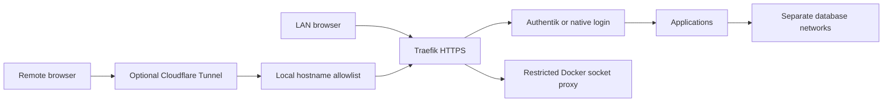

# How the system works

One Debian 13 host runs separate Docker Compose projects named `homelab-<stack>`. Bash installs host packages; the Python installer collects settings and calls the shared controller. The controller prepares directories and secrets, renders configuration and starts selected stacks.

The supported host uses rootful Docker Engine with its iptables firewall backend, Compose 2.33.1 or newer, and systemd. Rootless Docker and Docker's nftables backend are not configured by this repository.

## Files and storage

The primary drive holds the OS, source, application state, secrets and generated configuration in separate directories. The secondary drive holds personal/shared files, model weights and the default backup repository. The external drive holds existing media and downloads. Data and media mounts are checked by UUID before consumers start. See [storage](storage.md).

The installer stores host settings outside the checkout. Stack `.env` symlinks all point to that one file. A source update replaces only the recorded release directory; settings and state remain in place. Containers must then be recreated to use the new source binds. See [configuration](configuration.md) and [releases](releases.md).

## Requests and networks

AdGuard resolves application names to the server's LAN IP. Traefik terminates HTTPS using Cloudflare DNS-01 certificates and routes requests to applications. Authentik provides browser SSO and MFA where configured; some applications also require native accounts.

Applications share the proxy bridge, so they can reach each other's listening ports. Attach only trusted applications. PostgreSQL, Docker discovery and Cloudflare transport use separate networks. n8n and Ollama share an AI network for internal API calls. Internal clients use native API credentials rather than browser SSO.

Traefik reads discovery information through a restricted Docker socket proxy. Optional Dockge has full Docker authority and must remain private. The identity worker uses Authentik's embedded outpost and has no Docker socket.

Dockge discovers the same Compose sources through a read-only runtime view with project-matching directory names. This preserves existing `homelab-<stack>` identities and the single host environment; see [ADR 0001](decisions/0001-dockge-discovery.md).

Cloudflare Tunnel reaches a separate, unpublished Traefik entrypoint containing only approved remote routes. Private administration is unavailable there. Local administration uses source-IP restrictions and basic authentication in addition to native login where available. See [networking](networking.md), [authentication](authentication.md) and [security](security.md).

## Host services

Systemd runs the configured backup, monitoring, firewall and mount-check jobs. The media boot service is opt-in. FileBrowser, Homepage and AI require explicit deployment after reboot. Tailscale, Samba and the Beszel host agent have separate manual setup instructions.

Resource limits apply per container; they do not guarantee the host has enough memory for every stack. Start modules gradually and measure usage. See [hardware](hardware.md) and [daily operation](operations.md).
