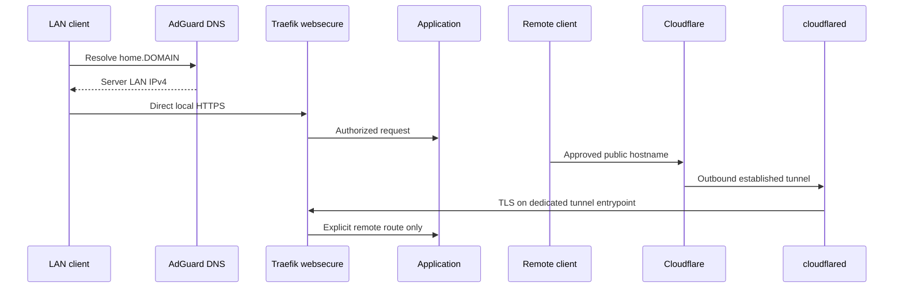

# DNS, HTTPS and access paths

## Local DNS

Reserve the host's LAN IPv4 using router DHCP. The wizard creates exact AdGuard service-hostname rewrites to that IP. Do not overwrite external unrelated zone records. Configure router DHCP option 6 to the AdGuard LAN IP after testing. Do not advertise a public secondary resolver to clients if deterministic split DNS is required: clients may choose it. Maintain a documented manual DNS recovery override. IPv6 RA/RDNSS can bypass IPv4 DNS settings; configure the router consistently or intentionally disable LAN IPv6 DNS advertisement.

## HTTPS and ports

Containers on the shared proxy network resolve `auth.DOMAIN` through Docker DNS to Traefik's network alias. Their OIDC discovery, token and user-info requests use local HTTPS on port 443 with the original hostname and certificate validation. This path does not depend on router DNS, AdGuard, public Cloudflare records or an active tunnel. Browser clients still need the split DNS setup above. Deploy the infrastructure stack after updating this alias; changing source alone does not modify an existing container's network configuration.

To diagnose an OIDC connection from Radarr, run `docker exec homelab-media-radarr-1 curl -sS --connect-timeout 5 --max-time 15 -o /dev/null -w 'HTTP %{http_code}, IP %{remote_ip}\n' https://auth.DOMAIN/application/o/APP_SLUG/.well-known/openid-configuration`, replacing the domain and application slug. Expect HTTP 200 and Traefik's Docker-network address. A public address and Cloudflare redirect indicate the internal alias is missing; a local 404 can indicate an incorrect application slug. Do not disable TLS verification or change the issuer to an internal HTTP service name.

Traefik binds LAN_IP:80 and :443, redirects HTTP to HTTPS and uses Cloudflare DNS-01 (no inbound ACME port needed). DNS token scope is limited to the intended zone. Local clients use split DNS and go directly to LAN HTTPS. The wizard selects production ACME; the example environment selects staging, whose certificates are intentionally untrusted. The dashboard is private and basic-authenticated; insecure dashboard mode is never enabled.

Ports: DNS 53 tcp/udp on LAN only, HTTPS 443/redirect 80, Plex 32400, qBittorrent peer 6881 tcp/udp. AdGuard setup 3001 and Authentik recovery 9000 are loopback-only. No PostgreSQL, Ollama, Docker API or public terminal host ports. qBittorrent's web interface is routed separately from peer traffic. Set torrent listen port consistently if changing the published peer port; no router mapping is automated.

## Remote routing

No inbound router forwarding is required. Cloudflare transport only reaches the unpublished :8443 tunnel entrypoint; local admin routers are never attached there. Its Host header cannot select the local dashboard. Cloudflare source headers are not trusted for private source rules. websecure does not trust forwarded client IPs. tunnel also discards untrusted forwarding headers; if you need original visitor IP attribution, configure a narrow trusted tunnel subnet and review the implications separately. Current n8n/web apps see the proxy chain's effective address, not necessarily the remote visitor.

## When DNS or HTTPS is unavailable

SSH to the numeric LAN IP; use a temporary client hosts entry or curl --resolve to test a hostname; change DNS client settings to the router/public resolver if AdGuard fails. Use local console if networking is unavailable. Never make emergency SSH depend on Traefik, Authentik or DNS. Tailscale can provide a second private route but is not a replacement for LAN recovery.
